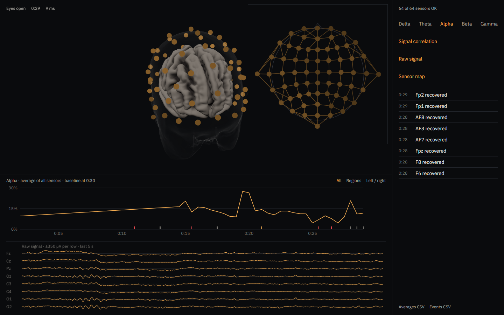
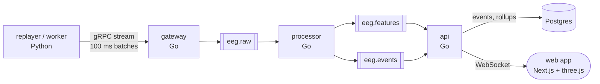
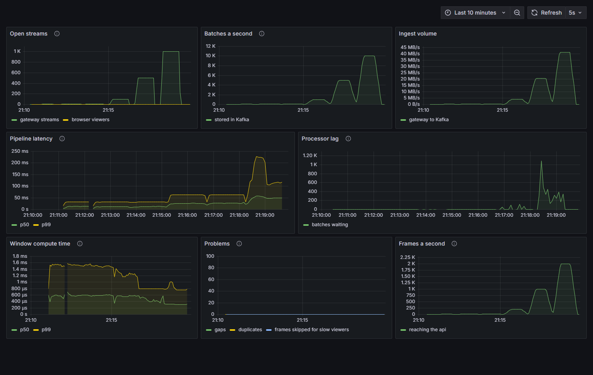

# NeuroHalo

NeuroHalo replays EEG recordings (brain activity recorded from sensors on the scalp) as live streams and shows them in the browser as they arrive. Each rhythm band is drawn on a 3D head twice a second, and a sensor that fails is flagged within seconds.

It is a streaming pipeline first: gRPC in, Kafka in the middle, WebSocket out. Research and education only, not for diagnosis.



## What it does

- **Start a session three ways:** play a built-in sample, upload an EDF file, or run the replayer from a terminal. All three go through the same pipeline.
- **Watch it live:** band strength (delta, theta, alpha, beta, gamma) per sensor on a 3D head, a chart against the session's own baseline, the raw signal, and a flat map of every sensor.
- **Catch bad sensors:** a sensor that goes flat or noisy gets a red ring and an event, and another event when it recovers.
- **Go back:** an ended session is stored as 10-second averages and events. Move a playhead through it, export CSV, or replay any stretch as a new live session.

## How it is built



| Piece | What it does |
| --- | --- |
| gateway | Checks the token, validates every batch, waits for Kafka's confirmation. Computes nothing |
| processor | FFT per sensor over a sliding 2-second window: band power, quality flags, events |
| api | Two Kafka consumers: one pushes frames to browsers, one writes history to Postgres. The live view never waits on the database |
| web | Next.js and React Three Fiber |

Every Kafka message is keyed by session ID, so one session's data stays in order. Every step is at-least-once, and duplicates are made harmless at each layer: sequence numbers in the processor, a unique constraint on events, and guarded upserts on rollups. [`docs/FLOW.md`](docs/FLOW.md) walks through the code function by function, including what happens when each piece fails.

## Load test

One laptop, everything in Docker Desktop, one instance of each service. Each session is 64 sensors at 160 samples a second.

| Sessions | Batches/s | MB/s | p50 latency | p99 latency |
| --- | --- | --- | --- | --- |
| 10 | 100 | 0.41 | 13 ms | 32 ms |
| 100 | 1,000 | 4.1 | 26 ms | 63 ms |
| 500 | 5,000 | 20.7 | 27 ms | 63 ms |
| 1,000 | 10,000 | 41.4 | 50 ms | 170 ms |

Latency is measured from the moment a batch is sent to the moment its result reaches the api, across the gateway, both Kafka hops and the processor. No stream failed and no batch was lost in any run. The runs were 60 seconds each, and the percentiles come from histogram buckets that double in width, so read them as "under 64 ms", not to the millisecond.



## Run it

You need Docker. Nothing else has to be installed.

```powershell
docker compose up -d --build
```

| Open | What |
| --- | --- |
| http://localhost:3000 | The app. Play a sample or upload an `.edf` file |
| http://localhost:3001 | Grafana, on the pipeline dashboard |
| http://localhost:9090 | Prometheus |

The samples are downloaded from PhysioNet the first time they are played.

To repeat the load test (this part needs [uv](https://docs.astral.sh/uv/) and PowerShell):

```powershell
cd replayer; uv run make_loadgen_data.py; cd ..
scripts/loadtest.ps1
```

## Credits

- Sample recordings: EEG Motor Movement/Imagery Dataset (Schalk et al., 2004), from [PhysioNet](https://physionet.org/content/eegmmidb/1.0.0/), Open Data Commons Attribution License v1.0.
- Head and brain surfaces: FreeSurfer fsaverage, via MNE-Python.

The code is under the MIT License.
