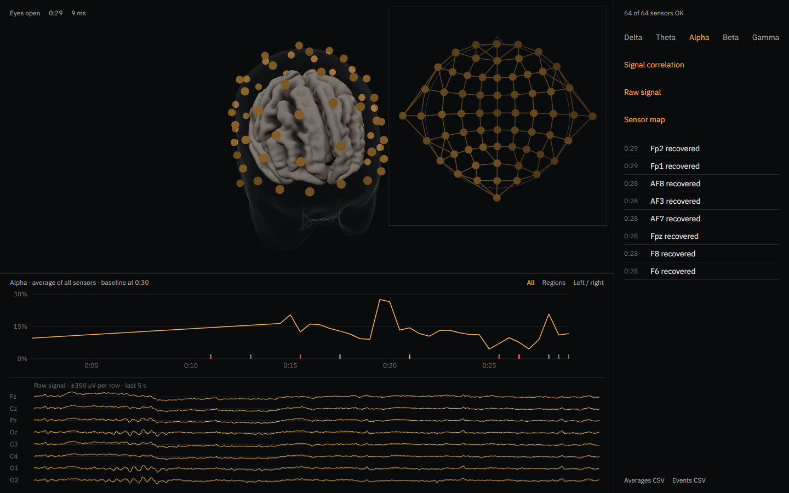
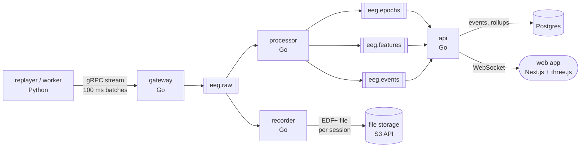
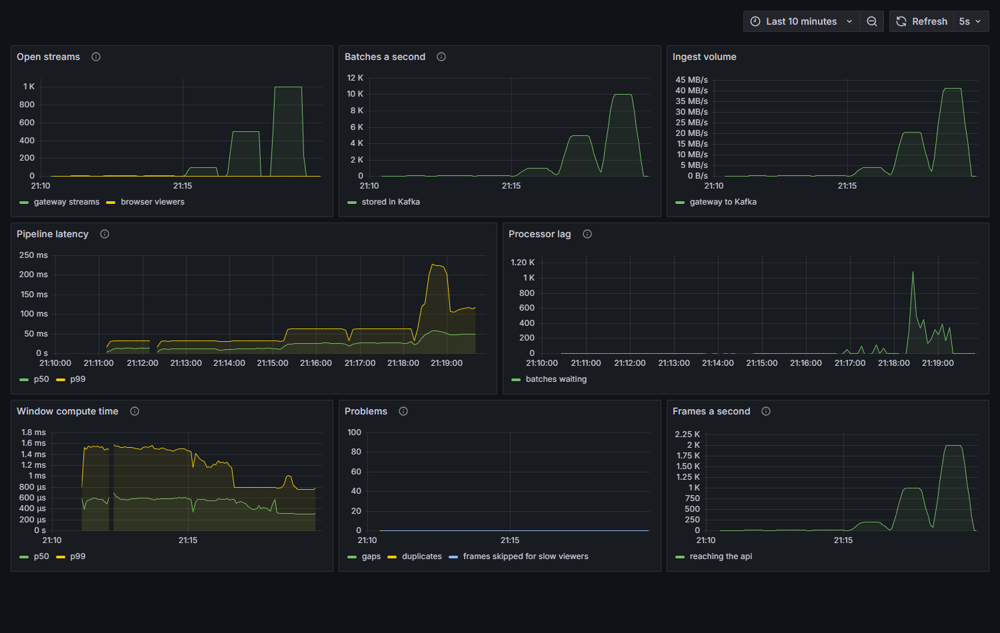

# NeuroHalo

[](https://github.com/KhoaNguyen706/NeuroHalo/actions/workflows/ci.yml)

NeuroHalo replays EEG recordings (brain activity recorded from sensors on the scalp) as live streams and shows them in the browser as they arrive. Each rhythm band is drawn on a 3D head twice a second, and a sensor that fails is flagged within seconds.

It is a streaming pipeline first: gRPC in, Kafka in the middle, WebSocket out. Research and education only, not for diagnosis.



## What it does

- **Start a session four ways:** play a built-in sample, upload an EDF file, run the replayer from a terminal, or forward a live amplifier stream over Lab Streaming Layer. All four go through the same pipeline.
- **Watch it live:** band strength (delta, theta, alpha, beta, gamma) per sensor on a 3D head, a chart against the session's own baseline, the raw signal, and a flat map of every sensor.
- **Catch bad sensors:** a sensor that goes flat or noisy gets a red ring and an event, and another event when it recovers.
- **Flag eye movements and muscle activity:** the two most common kinds of non-brain signal are listed as they start. The rules are simple thresholds, not checked against hand-labelled data.
- **See the experiment's markers:** when the recording or the live stream says "a cue was shown here", that moment is placed on the exact sample it belongs to, shown on the chart and kept in the event history.
- **See the averaged response build up:** the signal around every marker is cut out and averaged per label while the session runs, so the response to a cue shows after a handful of trials.
- **See the ERP:** the voltage after each kind of cue, averaged over its trials: filtered, baselined and with bad trials left out per sensor, the way ERP labs do it. The chart says how many trials each line still has, so you can tell during the session whether you will have enough.
- **Keep the raw signal:** every session is saved as an EDF+ file, the format EEGLAB, MNE and EDFbrowser open, with the markers inside it. It can be downloaded a few seconds after the session ends, including sessions from a live amplifier.
- **Organise a study:** put sessions in a study and mark each with who was recorded and what they did. The whole study downloads as a BIDS dataset, the folder layout labs share EEG data in and OpenNeuro accepts, with the markers as an events table and the sensors that failed during recording already marked bad. A session can be filed while it is still recording.
- **Go back:** an ended session is stored as 10-second averages and events. Move a playhead through it, export CSV, or replay any stretch as a new live session.

## How it is built



| Piece | What it does |
| --- | --- |
| gateway | Checks the token, validates every batch, waits for Kafka's confirmation. Computes nothing |
| processor | FFT per sensor over a sliding 2-second window: band power, quality flags, events, and the signal around each marker |
| recorder | Reads the same raw stream as its own consumer group. Uploads each session's batches every 2 seconds, then writes one EDF+ file when the session ends |
| api | Two Kafka consumers: one pushes frames to browsers, one writes history to Postgres. The live view never waits on the database |
| web | Next.js and React Three Fiber |

Every Kafka message is keyed by session ID, so one session's data stays in order. Every step is at-least-once, and duplicates are made harmless at each layer: sequence numbers in the processor and the recorder, a unique constraint on events, and guarded upserts on rollups. [`docs/FLOW.md`](docs/FLOW.md) walks through the code function by function, including what happens when each piece fails.

## Load test

One laptop, everything in Docker Desktop, one instance of each service. Each session is 64 sensors at 160 samples a second.

| Sessions | Batches/s | MB/s | p50 latency | p99 latency |
| --- | --- | --- | --- | --- |
| 10 | 100 | 0.41 | 13 ms | 32 ms |
| 100 | 1,000 | 4.1 | 26 ms | 63 ms |
| 500 | 5,000 | 20.7 | 27 ms | 63 ms |
| 1,000 | 10,000 | 41.4 | 50 ms | 170 ms |

Latency is measured from the moment a batch is sent to the moment its result reaches the api, across the gateway, both Kafka hops and the processor. No stream failed and no batch was lost in any run. The runs were 60 seconds each, and the percentiles come from histogram buckets that double in width, so read them as "under 64 ms", not to the millisecond.



## Checked with the tools labs use

The recording, the averaged responses and the ERPs are recomputed from the original file with MNE, the Python library many EEG labs analyse with, and compared number by number, on the "Left and right fist" sample (64 sensors, 125 s, 30 markers). The study download is checked with the official BIDS validator.

| Output | Check | Result |
| --- | --- | --- |
| The recorded EDF+ file | `replayer/check_recording.py`: read with MNE, compared with the file that was replayed | All 20,000 samples of all 64 sensors within 0.008 µV (half a step of the 16-bit scale), all 30 markers on their own sample |
| The averaged response per marker label | `replayer/check_responses.py`: the same epochs cut and averaged with MNE's Welch spectrum | Same 29 trials and the same sensors left out of each. In all 5 bands, 3 labels, 64 sensors and 21 time steps the power is exactly 4,800 × MNE's µV²/Hz (the Hann window's scale at 160 Hz), within 1.4 × 10⁻⁷. The change from before the marker matches within 0.0001 percentage points |
| The ERP per marker label | `replayer/check_erp.py`: MNE filters the whole recording with its default 30 Hz low-pass, `mne.Epochs` cuts and baselines the trials, the same rejection is applied | Same 29 trials and the same trials kept per sensor at each threshold (100 µV, 200 µV, none). Every averaged sample of all 64 sensors and 3 labels within 0.00002 µV |
| A study's BIDS download | The official BIDS validator (3.0.2), then MNE-BIDS reading every recording back | No errors on a study of 4 recordings, 3 participants and 2 tasks, one with 2 runs. MNE-BIDS finds every participant, task and run with all 64 sensors, 160 Hz and every marker. The validator's remaining warnings ask for what only the lab knows: authors and equipment software versions |
| Bad sensors in the BIDS download | The sample where sensor Cz fails 20 s in, exported and read with MNE-BIDS | Cz is marked bad ("flat from 23 s, 62% of the recording") and MNE puts it in its list of sensors to leave out, with no step by hand |

## When a service dies

The processors share the Kafka topic as one consumer group. Kill one, and Kafka hands its partitions to the others, which read on from the last committed offset. The recorder commits only after a chunk is stored, so after a crash Kafka delivers the rest again and the recorder drops the copies by sequence number.

| Test | Result |
| --- | --- |
| Docker Compose, 200 sessions, one of two processors killed (`scripts/failover.ps1`) | No stream failed and no batch was lost. The backlog peaked at 13,322 batches and was cleared 20 seconds after the kill |
| Docker Compose, the recorder killed 30 s into a 2-minute session and kept down for 26 s (`scripts/recorder_crash.ps1`) | The file was complete. Read with MNE and compared with the original: all 20,000 samples of all 64 sensors within 0.008 µV (half a step of the 16-bit scale), all 30 markers on their own sample |
| Kubernetes (kind), 6 sessions, one of two processor pods force-deleted (`scripts/k8s.ps1 demo`) | A replacement pod was running within 5 seconds. All sessions finished. The two sessions on the killed pod lost 4 seconds of frames each; the other four lost none |

## Live input

`replayer/lsl_bridge.py` forwards a Lab Streaming Layer stream, the way EEG amplifiers publish data on a network, into the pipeline as a live session. A marker stream on the same network, the way experiment software announces each cue, is forwarded with it. Both have been tested with the included simulator (`lsl_sim.py`), not with a real amplifier.

```powershell
cd replayer
uv run --group lsl lsl_sim.py       # terminal 1: a recording published as an amplifier would
uv run --group lsl lsl_bridge.py    # terminal 2: it appears on the home page as a live session
```

## Run it

You need Docker. Nothing else has to be installed.

```powershell
docker compose up -d --build
```

| Open | What |
| --- | --- |
| http://localhost:3000 | The app. Play a sample or upload an `.edf` file; "Studies" in the top bar groups sessions for a BIDS download |
| http://localhost:3001 | Grafana, on the pipeline dashboard |
| http://localhost:9090 | Prometheus |

The samples are downloaded from PhysioNet the first time they are played.

To repeat the load test (this part needs [uv](https://docs.astral.sh/uv/) and PowerShell):

```powershell
cd replayer; uv run make_loadgen_data.py; cd ..
scripts/loadtest.ps1
```

### On Kubernetes

`deploy/helm/neurohalo` is a Helm chart for the whole stack. `scripts/k8s.ps1 up` creates a local kind cluster and installs it; `scripts/k8s.ps1 down` removes it.

### On AWS

`deploy/terraform/main.tf` describes a single EC2 machine that runs the Compose stack, open only to your own IP address. It passes `terraform validate` but has not been applied.

## Credits

- Sample recordings: EEG Motor Movement/Imagery Dataset (Schalk et al., 2004), from [PhysioNet](https://physionet.org/content/eegmmidb/1.0.0/), Open Data Commons Attribution License v1.0.
- Head and brain surfaces: FreeSurfer fsaverage, via MNE-Python.

The code is under the MIT License.
