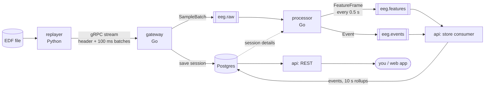
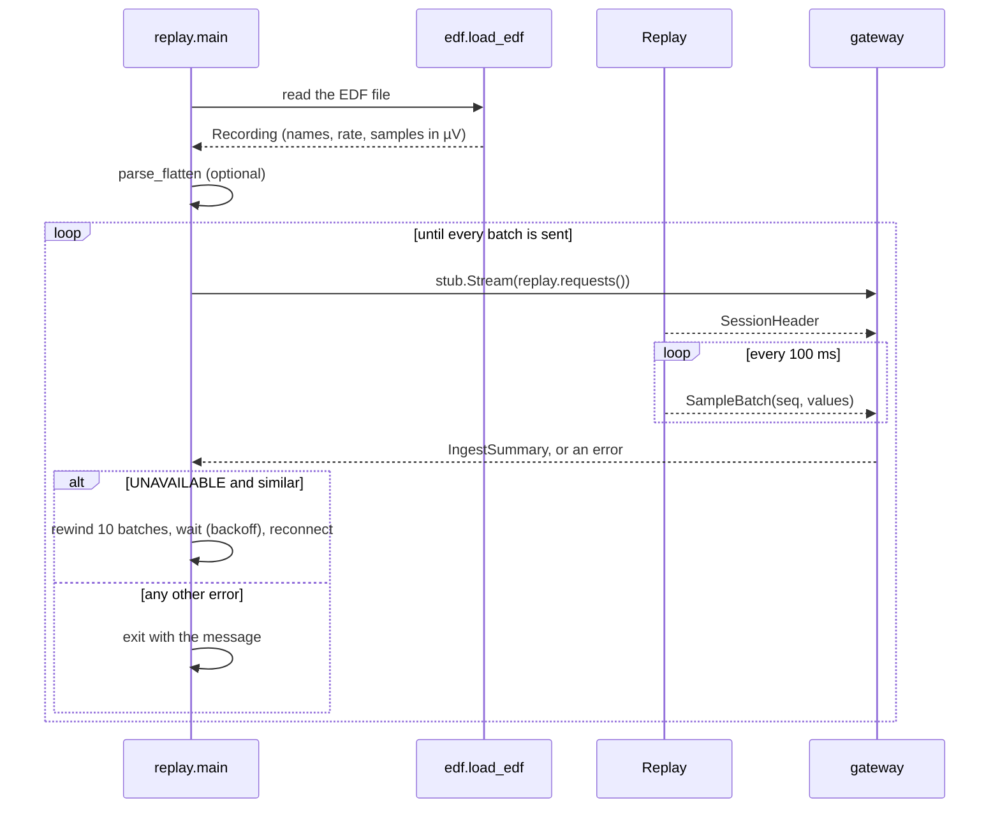
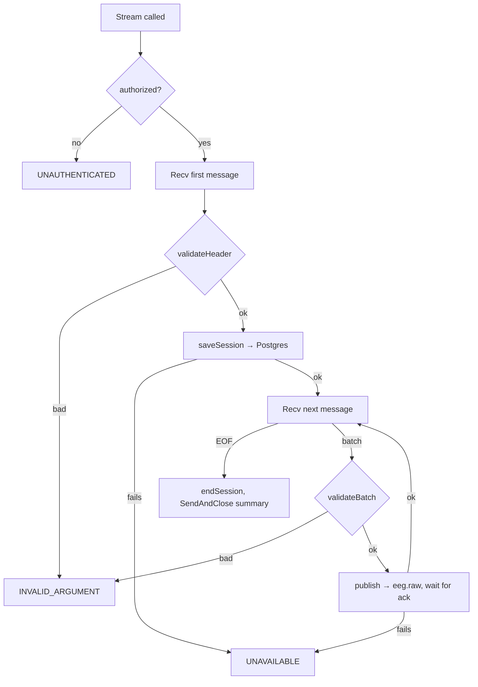
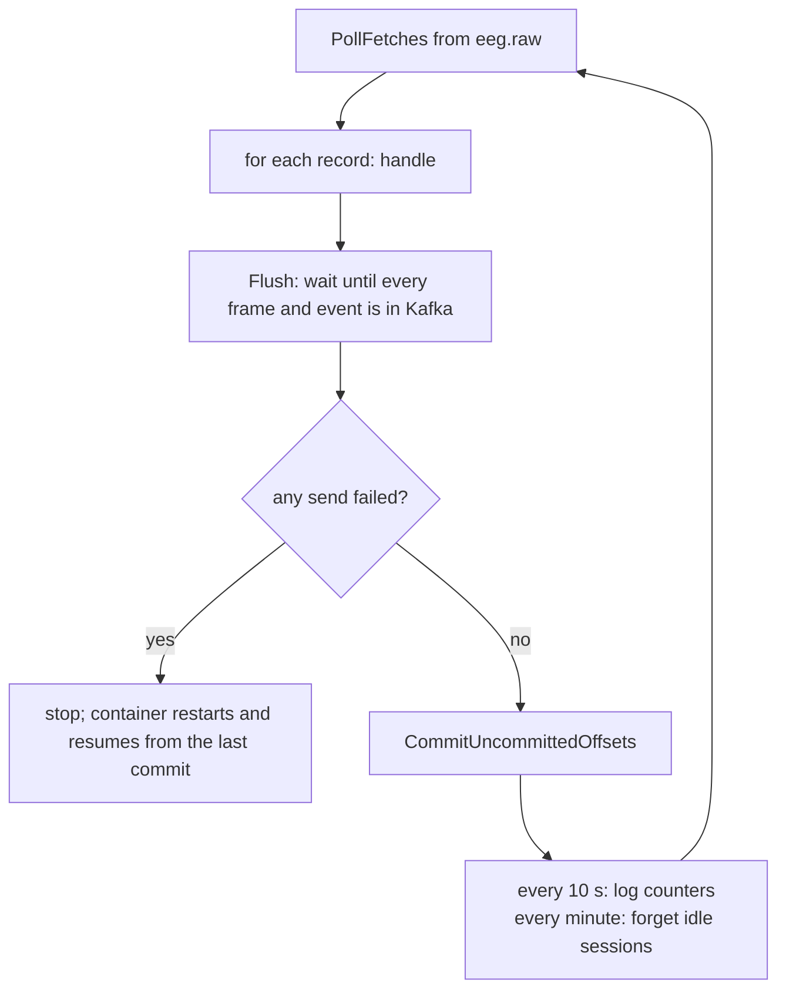
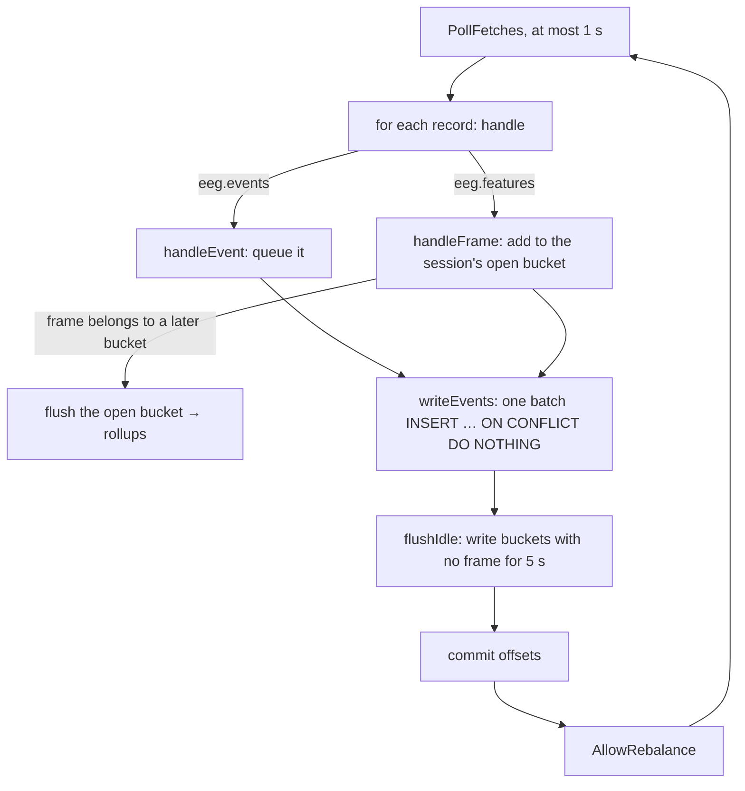

# How NeuroHalo works

This file follows the data through the code. The **high-level** part shows the pieces and what travels between them. The **low-level** part walks through each program function by function, in the order they run.

The reasons behind the design live in [`NeuroHalo v1 Low-Level Design.md`](../NeuroHalo%20v1%20Low-Level%20Design.md). This file describes what the code does today: build steps 1 to 5.

---

# Part 1: High level

## The big picture



One recording becomes a live stream, the stream becomes rhythm strength and events, and those end up in Postgres, where the REST API reads them.

## The pieces

| Piece | Folder | Job in one line |
| --- | --- | --- |
| replayer | `replayer/` | Reads an EDF file and sends it to the gateway at real speed |
| gateway | `gateway/` | Checks the token, validates every batch, forwards it to Kafka. Computes nothing |
| processor | `processor/` | Turns raw samples into band power, quality flags and events. Talks only to Kafka (and reads session details from Postgres) |
| api | `api/` | Stores events and rollups in Postgres; serves history over REST |
| signal math | `internal/eeg/` | FFT, band power, quality rules; shared by processor and api |
| contract | `proto/neuro/v1/` | The message formats every piece agrees on |
| featuretail | `tools/featuretail/` | Terminal viewer for what the processor writes (debugging only) |

## What travels between them

| From → to | Message | Size per session | Rate per session |
| --- | --- | --- | --- |
| replayer → gateway | `SessionHeader`, once per connection | names of 64 sensors | once |
| replayer → gateway | `SampleBatch`: 16 samples × 64 sensors | 1,024 floats ≈ 4 KB | 10 a second |
| gateway → `eeg.raw` | the same `SampleBatch`, unchanged | ≈ 4 KB | 10 a second |
| processor → `eeg.features` | `FeatureFrame`: 64 sensors × 5 bands + 64 quality flags | 320 floats | 2 a second |
| processor → `eeg.events` | `Event` (`channel_bad`, `channel_recovered`, `alpha_rise`) | small | only when something happens |
| api → Postgres | one `rollups` row per 10 seconds, event rows as they come | | 0.1 rows a second plus events |

Every Kafka message is **keyed by `session_id`**. Kafka sends all messages with the same key to the same partition, so one session's data always stays in order.

## Who owns which table

| Table | Written by | Read by |
| --- | --- | --- |
| `sessions` | gateway (when the header arrives, and when the stream ends) | processor, api |
| `events` | api store consumer | api REST |
| `rollups` | api store consumer | api REST |
| `summaries` | nobody yet (build step 11) | |

Raw samples are never stored in Postgres. The EDF files remain the source.

## Two clocks

The code uses two different times, and it matters which is which.

| Clock | Where it comes from | Used for |
| --- | --- | --- |
| **Sent time** | Replayer's wall clock when it sent a batch (`sent_time_unix_nanos`) | Measuring delay through the pipeline |
| **Recording time** | Session `started_at` + (samples so far ÷ sample rate) | Event times, rollup buckets |

Recording time does not change with replay speed, reconnects or which processor computed a window. So the same event computed twice has exactly the same time, and Postgres keeps only one copy.

## Delivery guarantees in one paragraph

Every step is **at least once**: after a crash, some messages can be read or sent again. Duplicates are made harmless at every layer:
- the processor drops a batch whose `seq` it has already seen;
- events have a `UNIQUE` constraint plus `ON CONFLICT DO NOTHING`;
- a rollup row is only replaced by one built from at least as many frames.

Consumers commit Kafka offsets only **after** their output is written, so nothing is lost.

---

# Part 2: Low level

The function names below are the real ones. Each function has a comment in the code saying what it does.

## 1. Replayer (`replayer/`)



**`edf.py`**
1. `load_edf(path)` reads the file with MNE (`read_raw_edf`).
2. Each channel name goes through `normalize_channel_name`, which strips the dots the dataset adds and fixes the casing against MNE's standard layout (`"Fc5."` → `"FC5"`).
3. Values are converted from volts to **microvolts** as `float32` and transposed to one row per sample, giving shape `(samples, 64)`.
4. It returns a `Recording`.

**`replay.py`**
1. `main()` parses the flags (`--file`, `--gateway`, `--session-id`, `--speed`, `--flatten`, `--token`).
2. `parse_flatten("Cz@20", rec)` zeroes that sensor's column from second 20 on, in place.
3. `Replay(rec, session_id, speed)` works out `batch_samples = 16` (100 ms at 160 Hz) and `num_batches`.
4. `Replay.requests()` is a **generator** that gRPC pulls messages from:
   - It yields the `SessionHeader` first.
   - It yields one `SampleBatch` per 100 ms, from `next_seq` on. Each send time is scheduled against `time.monotonic()` (`due = t0 + n × 0.1 / speed`), so timing never drifts.
   - It updates `next_seq` after each batch is taken.
5. The reconnect loop in `main()` works like this:
   - **Retryable errors** (`UNAVAILABLE`, `DEADLINE_EXCEEDED`, `ABORTED`): it moves `next_seq` back by `REWIND_BATCHES = 10`, because batches that were in flight may be lost. It waits with backoff (0.5 s doubling to 10 s), then opens a new stream. That stream resends the header with the same `session_id` and continues `seq`.
   - **Other errors**, such as a wrong token: it exits with the message.

## 2. Gateway (`gateway/main.go`)



1. `main()` reads `INGEST_TOKEN`, creates the Kafka client (franz-go defaults: `acks=all`, idempotent), opens the Postgres pool and serves gRPC on `:50051`.
2. `Stream()` runs once per client connection:
   - `authorized()` looks for `authorization: Bearer <token>` in the gRPC metadata. It compares in constant time.
   - The first message must be a header. `validateHeader()` checks it has a session ID, a positive sample rate and at least one channel.
   - `saveSession()` runs `INSERT … ON CONFLICT DO UPDATE SET status='live'`. A reconnect with the same ID therefore just sets the session live again; `started_at` never changes.
   - For each batch, `validateBatch()` checks three things: the same session ID, 1 to 16 samples, and exactly `num_samples × channels` values.
   - `publish()` serialises the batch and calls `ProduceSync`, which **waits** until Kafka confirms. So a batch the gateway counted is a batch Kafka has. It also means one session's batches go out one at a time, in order.
   - When the client closes the stream (`io.EOF`), `endSession()` sets `status='ended'` and the gateway replies with an `IngestSummary`.

## 3. Processor (`processor/` + `internal/eeg/`)

### The loop (`processor/main.go`)



`handle(record)`:
1. It decodes the `SampleBatch`.
2. It finds the session in `p.sessions`. On first sight it calls `loadSession()`, which reads `sample_rate_hz`, `channel_names` and `started_at` from Postgres and retries with backoff while Postgres is down. That pause also stops the processor from committing offsets.
3. It skips sessions Postgres doesn't know, and batches with the wrong number of values.
4. It calls `session.add(batch)`.
5. It queues every resulting frame to `eeg.features` and every event to `eeg.events` with `send()`. `send()` is asynchronous; the first error is saved in `produceErr`.

### One session's state (`processor/session.go`)

`newSession()` allocates the following:
- **a ring buffer** of 2 seconds × 64 sensors (`win = 320` rows);
- **an `eeg.Analyzer`** for 320-sample windows;
- **the list of back-of-head sensors** (names starting with `O` or `P`);
- **per-sensor counters** for quality runs.

`session.add(batch)` does the following:
1. **Duplicate:** if `seq ≤ lastSeq`, it drops the batch and reports `duplicate`.
2. **Gap:** if `seq > lastSeq + 1`, it clears the buffer and reports `gap`. The next window starts 2 seconds later.
3. It copies each of the 16 rows into the ring.
4. After each row, it checks whether the buffer is full and `sampleCount % 80 == 0`, that is, every 0.5 s on the **recording's** sample positions. If so, it runs:
   - `compute(windowIndex)` to get a `FeatureFrame`;
   - `detect(frame)` to get events.

   Because windows sit at fixed sample positions, window *N* is the same window no matter which processor computes it or when.

`compute()` copies each sensor's 320 samples out of the ring in time order. It calls `Analyzer.Analyze()` on them and fills `band_power` (64 × 5) and `quality` (64).

### The math (`internal/eeg/eeg.go`)

`NewAnalyzer(320, 160)` precomputes three things:
- the FFT plan (gonum `dsp/fourier`);
- the Hann window;
- a band index for each FFT bin. Bins are 0.5 Hz apart; those outside 1 to 45 Hz get `-1`.

`Analyze(window, out)` does the following:
1. Computes the mean, standard deviation and peak-to-peak of the window.
2. Subtracts the mean, multiplies by the Hann window, then runs the FFT.
3. Adds `|X|²` per band (delta 1–4, theta 4–8, alpha 8–13, beta 13–30, gamma 30–45 Hz).
4. Divides each band by the total from 1 to 45 Hz, giving relative strength from 0 to 1.
5. Sets the quality:
   - `FLAT` if the standard deviation is below 0.5 µV;
   - `NOISY` if the peak-to-peak is above 500 µV;
   - otherwise `OK`.

### Events (`session.detect`)

| Event | Rule in the code |
| --- | --- |
| `channel_bad` | A sensor that is not bad is non-OK for 3 windows in a row. It also fires again when a bad sensor's reason changes (noisy ↔ flat) for 3 windows in a row |
| `channel_recovered` | A bad sensor is OK for 3 windows in a row |
| `alpha_rise` | Mean back-of-head alpha is above 1.5 × the session's running average for 4 windows. It needs 10 windows of history first, and fires once per rise |

The event time is `windowTime(windowIndex)`, which is recording time (see "Two clocks").

## 4. Api (`api/`)

`main()` starts two things in one process: the **store consumer** and the **HTTP server** on `:8080`.

### Store consumer (`api/store.go`)



1. `handle()` records `offset + 1` for that topic and partition, then routes the record.
2. `handleFrame()` works out which 10-second bucket the frame falls in, from its window index:
   - `endSeconds = windowIndex × 80 / 160`, and `bucket = endSeconds / 10`.
   - **The open bucket is earlier:** it is complete, so `flush()` writes it first.
   - **The frame is for an earlier bucket:** that bucket is already written, so the frame is skipped. This happens when a processor recomputes after a restart.
   - Otherwise `bucket.add()` adds the frame. A window index seen before counts once.
3. `flush()` writes one `rollups` row with three columns:
   - `band_power`, averaged over the bucket's frames;
   - `bad_channels`, the sensors that were non-OK in more than half the frames;
   - `frames`, the number of frames averaged.

   The upsert only replaces an existing row `WHERE rollups.frames <= EXCLUDED.frames`, so a partial rebuild can never overwrite a complete row.
4. `writeEvents()` sends all of this poll's events in one `pgx.Batch`.
5. `commit()` is what makes crashes safe. For each partition it commits the offset after the last record handled, **except** on `eeg.features`, where it stops at `firstOffset` of any bucket not yet written. After a crash, those frames are read again and the bucket is rebuilt whole.
6. All Postgres calls go through `retry()`. Connection errors are retried with backoff, which also holds the offsets. Data errors return at once.
7. Kafka rebalances wait until a pass is finished (`BlockRebalanceOnPoll`). `dropPartitions()` forgets the state of partitions this consumer loses.

### REST (`api/http.go`)

`routes()` puts every path behind `requireToken()` (`Authorization: Bearer <token>`).

| Request | Handler | Query |
| --- | --- | --- |
| `GET /sessions` | `listSessions` | newest 100 by `started_at` |
| `GET /sessions/{id}` | `getSession` | one row, 404 if missing |
| `GET /sessions/{id}/events` | `listEvents` | `ORDER BY at, id` |
| `GET /sessions/{id}/rollups?from=&to=` | `listRollups` | `from <= bucket_start < to`, both optional (RFC 3339), plus the band names |

## 5. Life of one batch, end to end

Take sensor `O1`, seconds 30.0 to 30.1 of the eyes-closed recording:

1. **Replayer:** rows 4,800 to 4,815 become `SampleBatch{seq: 300, first_sample_index: 4800, values: 1,024 floats}`, sent at the scheduled moment.
2. **Gateway:** the batch passes `validateBatch` and goes to `eeg.raw`, keyed by the session ID. The gateway waits for Kafka's ack.
3. **Processor:** `add()` sees `seq 300 = lastSeq + 1` and copies the 16 rows into the ring. Row 4,800 brings the count to 4,800, which is a multiple of 80. So it computes window 60 (seconds 28.0 to 30.0) and runs `detect()`. Both outputs are sent; then the offset is committed.
4. **Api store:** window 60 ends at 30.0 s, so it goes into bucket 3 (30 to 40 s). When window 80 arrives, bucket 3 is flushed to `rollups` with `frames = 20`.
5. **REST:** `GET /sessions/{id}/rollups` returns that row, with `O1`'s alpha at `bandPower[O1 × 5 + 2]`.

## 6. When things break

| What breaks | What the code does | Where |
| --- | --- | --- |
| Gateway restarts | Replayer gets `UNAVAILABLE`, rewinds 10 batches, reconnects; the processor drops the 10 repeats by `seq` | `replay.main`, `session.add` |
| Kafka unreachable | `publish` times out after 5 s; the gateway returns `UNAVAILABLE`; the replayer retries | `server.publish` |
| A batch goes missing | The processor clears that session's buffer and counts a gap; windows resume 2 s later | `session.add` |
| Processor crashes | Its output was not committed, so Kafka gives the batches again; buffers refill in 2 s | `processor.run` |
| Api crashes mid-bucket | Offsets were held at the bucket's first frame, so the bucket is rebuilt whole | `store.commit` |
| Postgres down | Processor and api retry with backoff and hold their offsets | `loadSession`, `retry` |
| Wrong token | gateway: `UNAUTHENTICATED`; REST: 401 | `authorized`, `requireToken` |
| Wrong-size batch | `INVALID_ARGUMENT`, stream ends | `validateBatch` |

Tested so far: gateway restart, api restart mid-bucket, wrong token, gaps and duplicates. The Kafka-down and wrong-size paths are written but not yet exercised.

---

# Running it

```powershell
docker compose up -d --build                     # Kafka, Postgres, gateway, processor, api
cd replayer
uv run replay.py --file ../data/S001R02.edf      # eyes closed, real speed
uv run replay.py --file ../data/S001R02.edf --flatten Cz@20

docker compose run --rm featuretail              # watch frames and events live
curl -H "Authorization: Bearer dev-token" http://localhost:8080/sessions
```

| Task | Command |
| --- | --- |
| Any Go command (Go runs only in Docker) | `scripts/go.ps1 go test ./...` |
| Regenerate code after editing a `.proto` | `scripts/gen.ps1` |
| Look inside an EDF file | `uv run inspect_edf.py ../data/S001R01.edf` |

# Not built yet

| Step | What |
| --- | --- |
| 6 | WebSocket `/ws/sessions/{id}/live` and the Next.js 3D head |
| 8 | Prometheus metrics, Grafana |
| 9 | Go load generator |
| 10 | Kubernetes on kind |
| 11 | Summarizer and MCP server |
| 12 | README, demo video, AWS run |
