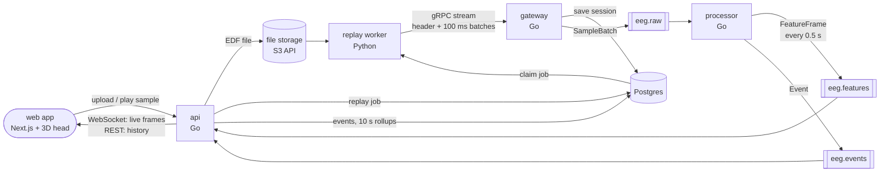
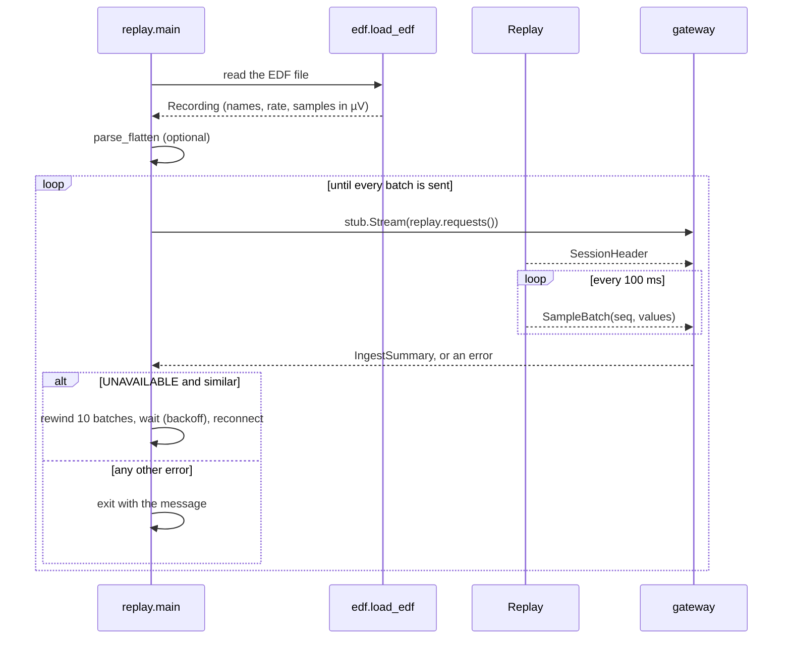
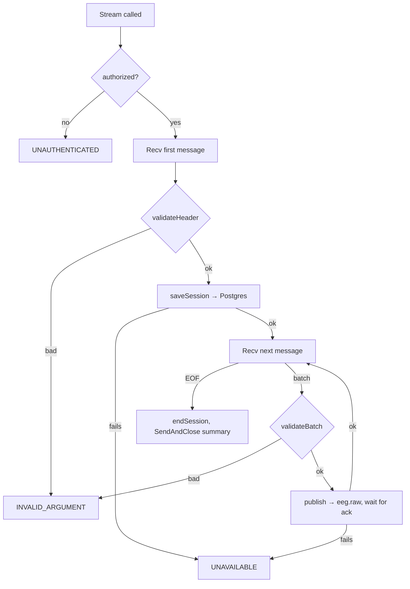
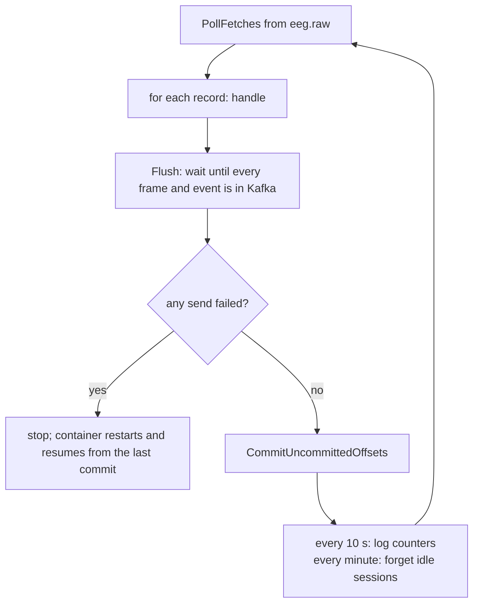
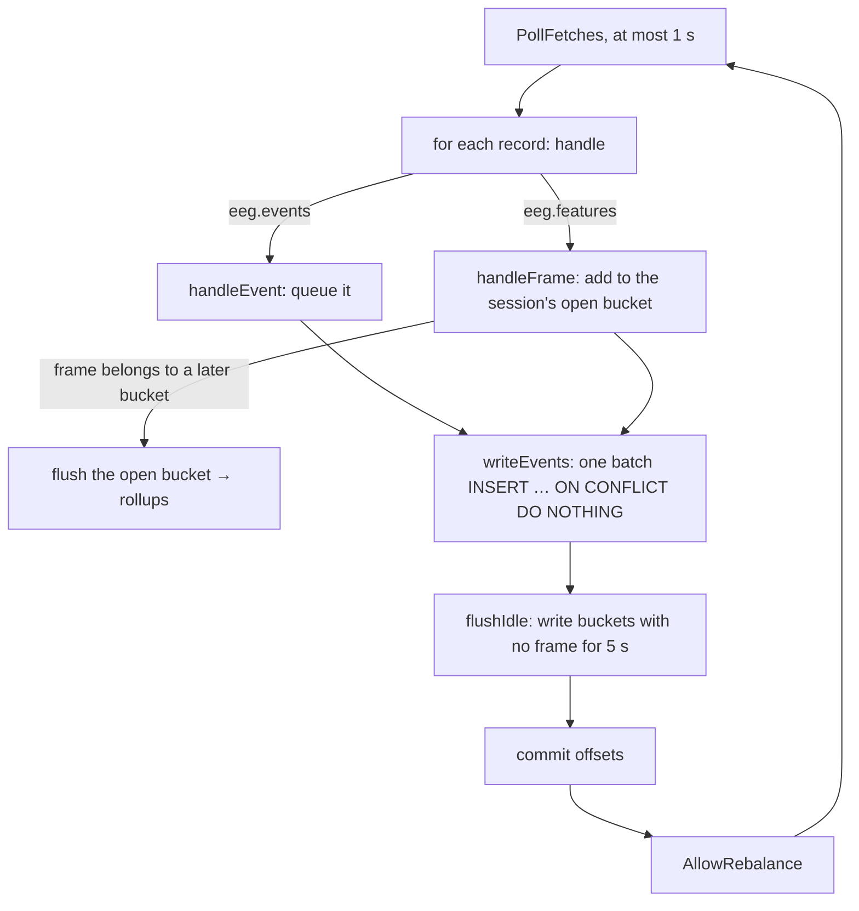
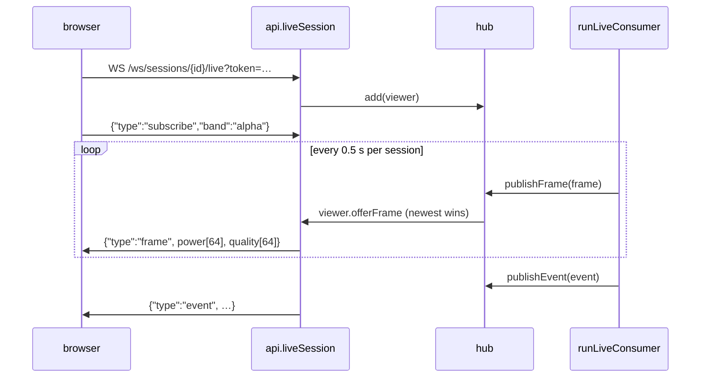
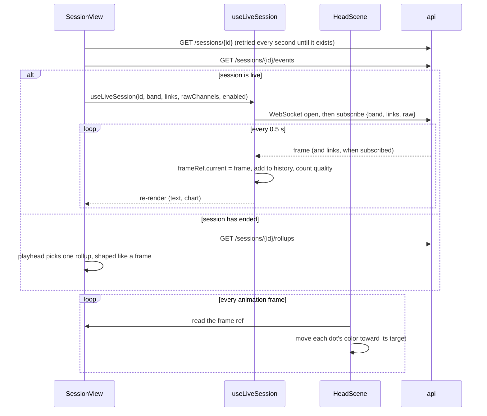

# How NeuroHalo works

This file follows the data through the code. The **high-level** part shows the pieces and what travels between them. The **low-level** part walks through each program function by function, in the order they run.

The reasons behind the design live in [`NeuroHalo v1 Low-Level Design.md`](../NeuroHalo%20v1%20Low-Level%20Design.md). This file describes what the code does today: build steps 1 to 9, plus samples and uploads.

---

# Part 1: High level

## The big picture



One recording becomes a live stream, and the stream becomes rhythm strength and events. Those go two ways at once: straight to the browser over a WebSocket, and into Postgres for history. The live path never waits on the database.

A session can start three ways, and all three feed the same pipeline: a built-in sample, an uploaded file, or the replayer run by hand in a terminal.

## The pieces

| Piece | Folder | Job in one line |
| --- | --- | --- |
| replayer | `replayer/replay.py` | Reads an EDF file and sends it to the gateway at real speed |
| replay worker | `replayer/worker.py` | Picks up replay jobs (samples and uploads) and runs the replayer for each |
| gateway | `gateway/` | Checks the token, validates every batch, forwards it to Kafka. Computes nothing |
| processor | `processor/` | Turns raw samples into band power, quality flags and events. Talks only to Kafka (and reads session details from Postgres) |
| api | `api/` | Stores events and rollups; serves history over REST; pushes live frames over WebSocket; accepts uploads |
| web | `web/` | The pages: start a session, then watch it live on a 3D head |
| file storage | SeaweedFS in Compose | Keeps uploaded EDF files behind the S3 API (S3 itself on AWS) |
| signal math | `internal/eeg/` | FFT, band power, quality rules; shared by processor and api |
| contract | `proto/neuro/v1/` | The message formats every piece agrees on |
| featuretail | `tools/featuretail/` | Terminal viewer for what the processor writes (debugging only) |
| loadgen | `tools/loadgen/` | Holds many streams open at once, to measure the pipeline |
| monitoring | `monitoring/` | Prometheus and Grafana settings, and the dashboard |

## What travels between them

| From → to | Message | Size per session | Rate per session |
| --- | --- | --- | --- |
| replayer → gateway | `SessionHeader`, once per connection | names of 64 sensors | once |
| replayer → gateway | `SampleBatch`: 16 samples × 64 sensors | 1,024 floats ≈ 4 KB | 10 a second |
| gateway → `eeg.raw` | the same `SampleBatch`, unchanged | ≈ 4 KB | 10 a second |
| processor → `eeg.features` | `FeatureFrame`: 64 sensors × 5 bands + 64 quality flags | 320 floats | 2 a second |
| processor → `eeg.events` | `Event` (`channel_bad`, `channel_recovered`, `alpha_rise`) | small | only when something happens |
| api → Postgres | one `rollups` row per 10 seconds, event rows as they come | | 0.1 rows a second plus events |
| api → browser | one band of a frame: 64 values + 64 quality flags, as JSON | about 1 KB | 2 a second per viewer |

Every Kafka message is **keyed by `session_id`**. Kafka sends all messages with the same key to the same partition, so one session's data always stays in order.

## Who owns which table

| Table | Written by | Read by |
| --- | --- | --- |
| `sessions` | gateway (when the header arrives, and when the stream ends) | processor, api |
| `events` | api store consumer | api REST |
| `rollups` | api store consumer | api REST |
| `replays` | api (queues a job), replay worker (claims it, records the result) | api REST, the session page while it waits |
| `summaries` | nobody yet (build step 11) | |

Raw samples are never stored in Postgres. The EDF files remain the source.

## Two clocks

The code uses two different times, and it matters which is which.

| Clock | Where it comes from | Used for |
| --- | --- | --- |
| **Sent time** | Replayer's wall clock when it sent a batch (`sent_time_unix_nanos`) | Measuring delay through the pipeline |
| **Recording time** | Session `started_at` + (samples so far ÷ sample rate) | Event times, rollup buckets |

Recording time does not change with replay speed, reconnects or which processor computed a window. So the same event computed twice has exactly the same time, and Postgres keeps only one copy.

## Delivery guarantees in one paragraph

Every step is **at least once**: after a crash, some messages can be read or sent again. Duplicates are made harmless at every layer:
- the processor drops a batch whose `seq` it has already seen;
- events have a `UNIQUE` constraint plus `ON CONFLICT DO NOTHING`;
- a rollup row is only replaced by one built from at least as many frames.

Consumers commit Kafka offsets only **after** their output is written, so nothing is lost.

---

# Part 2: Low level

The function names below are the real ones. Each function has a comment in the code saying what it does.

## 1. Replayer (`replayer/`)



**`edf.py`**
1. `load_edf(path)` reads the file with MNE (`read_raw_edf`).
2. Each channel name goes through `normalize_channel_name`, which strips the dots the dataset adds and fixes the casing against MNE's standard layout (`"Fc5."` → `"FC5"`).
3. Values are converted from volts to **microvolts** as `float32` and transposed to one row per sample, giving shape `(samples, 64)`.
4. It returns a `Recording`.

**`replay.py`**
1. `main()` parses the flags (`--file`, `--gateway`, `--session-id`, `--speed`, `--flatten`, `--token`).
2. `parse_flatten("Cz@20", rec)` zeroes that sensor's column from second 20 on, in place.
3. `Replay(rec, session_id, speed)` works out `batch_samples = 16` (100 ms at 160 Hz) and `num_batches`.
4. `Replay.requests()` is a **generator** that gRPC pulls messages from:
   - It yields the `SessionHeader` first.
   - It yields one `SampleBatch` per 100 ms, from `next_seq` on. Each send time is scheduled against `time.monotonic()` (`due = t0 + n × 0.1 / speed`), so timing never drifts.
   - It updates `next_seq` after each batch is taken.
5. The reconnect loop in `main()` works like this:
   - **Retryable errors** (`UNAVAILABLE`, `DEADLINE_EXCEEDED`, `ABORTED`): it moves `next_seq` back by `REWIND_BATCHES = 10`, because batches that were in flight may be lost. It waits with backoff (0.5 s doubling to 10 s), then opens a new stream. That stream resends the header with the same `session_id` and continues `seq`.
   - **Other errors**, such as a wrong token: it exits with the message.

## 2. Gateway (`gateway/main.go`)



1. `main()` reads `INGEST_TOKEN`, creates the Kafka client (franz-go defaults: `acks=all`, idempotent), opens the Postgres pool and serves gRPC on `:50051`.
2. `Stream()` runs once per client connection:
   - `authorized()` looks for `authorization: Bearer <token>` in the gRPC metadata. It compares in constant time.
   - The first message must be a header. `validateHeader()` checks it has a session ID, a positive sample rate and at least one channel.
   - `saveSession()` runs `INSERT … ON CONFLICT DO UPDATE SET status='live'`. A reconnect with the same ID therefore just sets the session live again; `started_at` never changes.
   - For each batch, `validateBatch()` checks three things: the same session ID, 1 to 16 samples, and exactly `num_samples × channels` values.
   - `publish()` serialises the batch and calls `ProduceSync`, which **waits** until Kafka confirms. So a batch the gateway counted is a batch Kafka has. It also means one session's batches go out one at a time, in order.
   - When the client closes the stream (`io.EOF`), `endSession()` sets `status='ended'` and the gateway replies with an `IngestSummary`.

## 3. Processor (`processor/` + `internal/eeg/`)

### The loop (`processor/main.go`)



`handle(record)`:
1. It decodes the `SampleBatch`.
2. It finds the session in `p.sessions`. On first sight it calls `loadSession()`, which reads `sample_rate_hz`, `channel_names` and `started_at` from Postgres and retries with backoff while Postgres is down. That pause also stops the processor from committing offsets.
3. It skips sessions Postgres doesn't know, and batches with the wrong number of values.
4. It calls `session.add(batch)`.
5. It queues every resulting frame to `eeg.features` and every event to `eeg.events` with `send()`. `send()` is asynchronous; the first error is saved in `produceErr`.

### One session's state (`processor/session.go`)

`newSession()` allocates the following:
- **a ring buffer** of 2 seconds × 64 sensors (`win = 320` rows);
- **an `eeg.Analyzer`** for 320-sample windows;
- **the list of back-of-head sensors** (names starting with `O` or `P`);
- **per-sensor counters** for quality runs.

`session.add(batch)` does the following:
1. **Duplicate:** if `seq ≤ lastSeq`, it drops the batch and reports `duplicate`.
2. **Gap:** if `seq > lastSeq + 1`, it clears the buffer and reports `gap`. The next window starts 2 seconds later.
3. It copies each of the 16 rows into the ring.
4. After each row, it checks whether the buffer is full and `sampleCount % 80 == 0`, that is, every 0.5 s on the **recording's** sample positions. If so, it runs:
   - `compute(windowIndex)` to get a `FeatureFrame`;
   - `detect(frame)` to get events.

   Because windows sit at fixed sample positions, window *N* is the same window no matter which processor computes it or when.

`compute()` copies each sensor's 320 samples out of the ring in time order. It calls `Analyzer.Analyze()` on them and fills `band_power` (64 × 5) and `quality` (64).

### The math (`internal/eeg/eeg.go`)

`NewAnalyzer(320, 160)` precomputes three things:
- the FFT plan (gonum `dsp/fourier`);
- the Hann window;
- a band index for each FFT bin. Bins are 0.5 Hz apart; those outside 1 to 45 Hz get `-1`.

`Analyze(window, out)` does the following:
1. Computes the mean, standard deviation and peak-to-peak of the window.
2. Subtracts the mean, multiplies by the Hann window, then runs the FFT.
3. Adds `|X|²` per band (delta 1–4, theta 4–8, alpha 8–13, beta 13–30, gamma 30–45 Hz).
4. Divides each band by the total from 1 to 45 Hz, giving relative strength from 0 to 1.
5. Sets the quality:
   - `FLAT` if the standard deviation is below 0.5 µV;
   - `NOISY` if the peak-to-peak is above 500 µV;
   - otherwise `OK`.

### Events (`session.detect`)

| Event | Rule in the code |
| --- | --- |
| `channel_bad` | A sensor that is not bad is non-OK for 3 windows in a row. It also fires again when a bad sensor's reason changes (noisy ↔ flat) for 3 windows in a row |
| `channel_recovered` | A bad sensor is OK for 3 windows in a row |
| `alpha_rise` | Mean back-of-head alpha is above 1.5 × the session's running average for 4 windows. It needs 10 windows of history first, and fires once per rise |
| `eye_movement`, `muscle` | See "Eye movements and muscle activity" below |

The event time is `windowTime(windowIndex)`, which is recording time (see "Two clocks").

## 4. Api (`api/`)

`main()` starts two things in one process: the **store consumer** and the **HTTP server** on `:8080`.

### Store consumer (`api/store.go`)



1. `handle()` records `offset + 1` for that topic and partition, then routes the record.
2. `handleFrame()` works out which 10-second bucket the frame falls in, from its window index:
   - `endSeconds = windowIndex × 80 / 160`, and `bucket = endSeconds / 10`.
   - **The open bucket is earlier:** it is complete, so `flush()` writes it first.
   - **The frame is for an earlier bucket:** that bucket is already written, so the frame is skipped. This happens when a processor recomputes after a restart.
   - Otherwise `bucket.add()` adds the frame. A window index seen before counts once.
3. `flush()` writes one `rollups` row with three columns:
   - `band_power`, averaged over the bucket's frames;
   - `bad_channels`, the sensors that were non-OK in more than half the frames;
   - `frames`, the number of frames averaged.

   The upsert only replaces an existing row `WHERE rollups.frames <= EXCLUDED.frames`, so a partial rebuild can never overwrite a complete row.
4. `writeEvents()` sends all of this poll's events in one `pgx.Batch`.
5. `commit()` is what makes crashes safe. For each partition it commits the offset after the last record handled, **except** on `eeg.features`, where it stops at `firstOffset` of any bucket not yet written. After a crash, those frames are read again and the bucket is rebuilt whole.
6. All Postgres calls go through `retry()`. Connection errors are retried with backoff, which also holds the offsets. Data errors return at once.
7. Kafka rebalances wait until a pass is finished (`BlockRebalanceOnPoll`). `dropPartitions()` forgets the state of partitions this consumer loses.

### REST (`api/http.go`)

`routes()` puts every path behind `requireToken()` (`Authorization: Bearer <token>`).

| Request | Handler | Query |
| --- | --- | --- |
| `GET /sessions` | `listSessions` | newest 100 by `started_at`, load-test sessions left out |
| `GET /sessions/{id}` | `getSession` | one row, 404 if missing |
| `DELETE /sessions/{id}` | `deleteSession` | removes an ended session with its events, rollups and replay job in one transaction; 409 while it is live |
| `GET /sessions/{id}/events` | `listEvents` | `ORDER BY at, id` |
| `GET /sessions/{id}/rollups?from=&to=` | `listRollups` | `from <= bucket_start < to`, both optional (RFC 3339), plus the band names |

### Live view (`api/live.go`)



1. `runLiveConsumer()` reads every partition of `eeg.features`, `eeg.events` and `eeg.raw`, starting from the newest message. It uses no consumer group and commits nothing, so every api instance sees every frame. A raw batch is only decoded when a viewer of that session asked for raw signal (`hub.wantsRaw`, decided from the message key).
2. The `hub` maps a session ID to its viewers. `publishFrame()` calls `viewer.offerFrame()`.
3. Each `viewer` has a **one-frame slot**. If the slot still holds an unsent frame, the new frame replaces it and `framesDropped` goes up. A slow viewer therefore skips to the newest frame and never slows anyone else.
4. `liveSession()` handles one WebSocket. A reader goroutine takes `subscribe` messages and stores the band. The write loop sends frames (cut down to that band by `frameMessage()`), events, and a ping every 30 s.
5. Browsers cannot set headers on a WebSocket, so `requireToken()` accepts `?token=` on `/ws/` paths. The `Origin` header must match `WEB_ORIGIN`.
6. The `subscribe` message has two optional parts:
   - `"links": true` adds a `links` message after each frame: the window's strongest correlated sensor pairs as `[a, b, strength]`. The processor only computes them when `LINKS_ENABLED` is on (`processor/links.go`): Pearson correlation over the 2-second window, for pairs at least `MIN_LINK_ANGLE_DEG` apart on the head, strongest 50 kept.
   - `"raw": [3, 10]` adds a `raw` message ten times a second with the samples of those channels (at most 8), cut out of the raw batch by `rawMessage()`.

### Samples and uploads (`api/uploads.go`, `api/edf.go`)

| Request | Handler | What it does |
| --- | --- | --- |
| `GET /samples` | `listSamples` | The three built-in samples |
| `POST /samples/{name}/play?speed=1x\|fast` | `playSample` | Queues a replay of a sample; returns the new session ID |
| `POST /uploads` (multipart `file`, `speed`) | `upload` | Checks, stores and queues an uploaded EDF; returns the session ID and what the header says |
| `GET /replays/{id}` | `getReplay` | The job's state: queued, running, done or failed with a message |
| `POST /sessions/{id}/replay?from=&to=&speed=` | `replayFrom` | Queues a new replay of the recording behind an earlier session, from `from` seconds to `to` seconds; returns the new session ID |

`upload()` runs these checks in order and stops at the first failure:
1. The body is at most 50 MB (`http.MaxBytesReader`); otherwise 413.
2. The file name ends in `.edf`; otherwise 400.
3. `parseEDFHeader()` reads only the header and checks the version field, the header size against the signal count, and that the file is long enough for the records it promises. Otherwise 422 with the reason.
4. The file is stored as `uploads/<generated id>.edf`. The name the user sent is cleaned by `cleanLabel()` and kept only as a display label.
5. `queueReplay()` inserts a `replays` row with status `queued`.

The session row itself does not exist yet. The gateway creates it when the worker's stream sends its header.

## 5. Replay worker (`replayer/worker.py`)

1. `main()` first marks any job left `running` by an earlier worker as failed. Then it loops, running at most `MAX_JOBS` (8) replays at once, each in its own thread.
2. `claim()` takes the oldest queued job with `UPDATE … WHERE session_id = (SELECT … FOR UPDATE SKIP LOCKED)`. Two workers can never take the same job.
3. `run_job()` gets the recording:
   - **upload:** downloads the object from file storage to a temporary file;
   - **sample:** `sample_path()` looks in the mounted `data/` folder and the cache, and otherwise downloads the file from PhysioNet. Only names shaped like `S001R02.edf` are accepted.
4. It then calls the same code as the command-line replayer: `load_edf()`, `apply_flatten()`, `stream_recording()`. Speed `fast` is an infinite speed factor, so batches go out as fast as the gateway takes them.
5. `finish()` records `done`, or `failed` with the error message, which the page shows.

## 6. Web app (`web/`)

| File | Job |
| --- | --- |
| `src/lib/api.ts` | REST calls, the WebSocket address, and the types of every answer |
| `src/app/page.tsx` | Home: upload area, sample list, session list (refreshed every 3 s) with delete, theme switch |
| `src/app/sessions/[id]/page.tsx` | The session page: layout, rail, popover, chart lines, history playhead, replay form |
| `src/app/sessions/[id]/page.module.css` | That page's styles |
| `src/hooks/useLiveSession.ts` | All WebSocket logic |
| `src/hooks/useBaseline.ts` | Each sensor's band strength over the session's first 30 seconds, from the stored rollups |
| `src/components/HeadScene.tsx` | The 3D scene of the session page: brain, sensor dots, rings, correlation lines |
| `src/components/Timeline.tsx` | The band strength chart under the head |
| `src/components/RawTraces.tsx` | The scrolling raw signal, and one sensor's frequency spectrum |
| `src/components/SensorMap.tsx` | The flat map of the head seen from above |
| `src/lib/regions.ts` | Brain region and side from a sensor's name (`F3` is frontal, left) |
| `src/lib/export.ts` | The two CSV downloads |
| `src/lib/theme.ts`, `src/components/ThemeToggle.tsx` | Light and dark theme |
| `src/positions.json` | Sensor name → x, y, z, generated once by `replayer/make_positions.py` |
| `src/lib/model.ts`, `public/model/` | The brain and head surfaces (FreeSurfer fsaverage), generated once by `replayer/make_head_model.py` |
| `src/components/Head3D.tsx`, `src/lib/color.ts` | The turning brain on the home page |

### Session page

The page has two columns. On the left: the 3D head with three small readouts in its top-left corner (session name, elapsed time, delay), the chart under it, and the raw signal under that when it is switched on. On the right, a 320 px rail: data quality, the band selector, three toggles (Signal correlation, Raw signal, Sensor map), the replay form for an ended session, the event list and the CSV exports.

The page works in two modes, chosen by the session's status.

| | Live session | Ended session |
| --- | --- | --- |
| Head and chart show | Frames from the WebSocket, twice a second | The stored 10-second rollups (`GET /sessions/{id}/rollups`) |
| Moving through time | Not possible; it shows now | A click or drag on the chart moves a playhead |
| Events | Stored ones (`GET /sessions/{id}/events`) plus new ones from the WebSocket | Stored ones |
| Correlation, raw signal | Available | Off: neither is stored |
| Replay | — | "Replay from … to …" starts a new live session over that stretch |



**`useLiveSession(id, band, links, rawChannels, enabled)`**
1. It opens the WebSocket and sends `subscribe` with the band, whether links are wanted, and the channels wanted as raw signal. It sends it again whenever one of them changes.
2. Each frame is stored in `frameRef`, a ref, so the 3D scene can read it without React re-rendering. A frame that still carries the previous band is ignored.
3. Elapsed time (`windowIndex × 0.5 s`) and delay (`Date.now() − sentTimeMs`) are state, so the page re-renders once per frame from the server.
4. It keeps a history of frames for the chart, and running quality counts per sensor (`QualityStats`): how often each was bad, and for how long it has been bad now.
5. `links` messages go to `linksRef`, `raw` messages into `rawRef`, a ring buffer per watched sensor. Both are refs, read by the drawing loops.
6. Events are added to the front of a list.
7. When the socket closes, `status` becomes `reconnecting` and it retries with backoff.

**`HeadScene`**
1. It loads the brain model. `placeSensors()` puts each channel on the model's scalp; if the model cannot be loaded, a grey stretched sphere stands in and `positions.json` is used. A channel with no known position goes in a row under the head.
2. `Brain` draws the brain inside a glass head. `Sensors` draws all dots as one `InstancedMesh` and all red rings as a second.
3. Inside `useFrame`, each dot's color moves part of the way toward its target every animation frame. The target is the band's relative power on the theme's scale, with 60% or more at full strength. Before the first frame every dot is grey.
4. A ring is shown for every channel whose `quality` in the newest frame is not OK.
5. `Links` draws the correlation pairs as arcs over the head, in one `LineSegments` geometry. A line's opacity eases toward its strength. Lines touching a sensor that turns bad go red and stay until it recovers.
6. `OrbitControls` allows rotation and limited zoom, no panning. The head turns slowly by itself until the first drag.
7. `HeadScene` is wrapped in `memo` and gets only stable props, so the page's twice-a-second updates never re-render it.

**`Timeline`** draws band strength over time. The page chooses the lines: the average of all sensors, one line per brain region, left against right, or the highlighted sensor alone. It also draws the baseline as a dashed line and a tick for each event.

**`useBaseline`** reads the first three stored rollups (30 seconds) and averages them per sensor and band, leaving out rollups where the sensor was bad. The chart title and the popover compare against it ("+17% vs baseline").

**`RawTraces`** draws the watched sensors' raw signal on a canvas every animation frame: eight standard sensors, or the highlighted one alone, which then also gets its frequency spectrum.

**`SensorMap`** draws every sensor at once, flattened as seen from above, in the same color scale.

**Theme.** Every color is a CSS variable in `globals.css`, once per theme; `<html data-theme>` picks the set. A script in `layout.tsx` sets it before the first paint from the saved choice, or the system setting. The canvas and the 3D scene cannot use CSS variables, so they read them through `usePalette()`. The switch is on the home page only.

**Other behaviour**
- The top-left text shows "Waiting for data" until the first frame, "Reconnecting…" while the socket is down, and "Ended" with the playhead's time range for an ended session.
- Clicking a dot opens a popover: channel name, current value, comparison with the baseline, quality, and how much of the time it was bad.
- Clicking an event highlights its sensor and marks its tick on the chart.
- After 5 seconds without a frame, the page asks the api whether the session has ended, and switches to history when it has.
- On a narrow screen the rail moves below the head.

## 7. Life of one batch, end to end

Take sensor `O1`, seconds 30.0 to 30.1 of the eyes-closed recording:

1. **Replayer:** rows 4,800 to 4,815 become `SampleBatch{seq: 300, first_sample_index: 4800, values: 1,024 floats}`, sent at the scheduled moment.
2. **Gateway:** the batch passes `validateBatch` and goes to `eeg.raw`, keyed by the session ID. The gateway waits for Kafka's ack.
3. **Processor:** `add()` sees `seq 300 = lastSeq + 1` and copies the 16 rows into the ring. Row 4,800 brings the count to 4,800, which is a multiple of 80. So it computes window 60 (seconds 28.0 to 30.0) and runs `detect()`. Both outputs are sent; then the offset is committed.
4. **Api store:** window 60 ends at 30.0 s, so it goes into bucket 3 (30 to 40 s). When window 80 arrives, bucket 3 is flushed to `rollups` with `frames = 20`.
5. **Live:** window 60 also reaches the live consumer, and every viewer of this session gets `{"type":"frame","windowIndex":60,…}` with `O1`'s alpha in `power`. On one machine this takes about 5 to 15 ms from the moment the batch was sent.
6. **REST:** `GET /sessions/{id}/rollups` returns the bucket's row, with `O1`'s alpha at `bandPower[O1 × 5 + 2]`.

## 8. When things break

| What breaks | What the code does | Where |
| --- | --- | --- |
| Gateway restarts | Replayer gets `UNAVAILABLE`, rewinds 10 batches, reconnects; the processor drops the 10 repeats by `seq` | `replay.main`, `session.add` |
| Kafka unreachable | `publish` times out after 5 s; the gateway returns `UNAVAILABLE`; the replayer retries | `server.publish` |
| A batch goes missing | The processor clears that session's buffer and counts a gap; windows resume 2 s later | `session.add` |
| Processor crashes | Its output was not committed, so Kafka gives the batches again; buffers refill in 2 s | `processor.run` |
| Api crashes mid-bucket | Offsets were held at the bucket's first frame, so the bucket is rebuilt whole | `store.commit` |
| Postgres down | Processor and api retry with backoff and hold their offsets | `loadSession`, `retry` |
| Wrong token | gateway: `UNAUTHENTICATED`; REST: 401 | `authorized`, `requireToken` |
| Wrong-size batch | `INVALID_ARGUMENT`, stream ends | `validateBatch` |
| A viewer is slow | It skips to the newest frame; other viewers are unaffected | `viewer.offerFrame` |
| The WebSocket drops | The page shows "Reconnecting…", reconnects with backoff and subscribes again. Events that fire while it is down are not shown | `useLiveSession` |
| An upload is not a real EDF | Rejected with 422 and the reason, before anything is stored | `parseEDFHeader` |
| The recording cannot be read after upload | The job is marked failed with a message, readable at `GET /replays/{id}`. The live page does not show it; it stays on "Waiting for data" | `worker.run_job` |
| The worker restarts mid-replay | That replay is marked failed; queued jobs run as normal | `worker.main` |

Tested so far: gateway restart, api restart mid-bucket, wrong token (gRPC, REST and WebSocket), a foreign WebSocket origin, gaps and duplicates, bad uploads, and a WebSocket drop (api restarted while a page was watching). Written but not yet exercised: Kafka down, a wrong-size batch, a slow viewer under real load, and a worker restart.

---

# Running it

```powershell
docker compose up -d --build                     # the whole stack
# then open http://localhost:3000, play a sample or upload an .edf file
```

From a terminal, without the page:

```powershell
cd replayer
uv run replay.py --file ../data/S001R02.edf      # eyes closed, real speed
uv run replay.py --file ../data/S001R02.edf --flatten Cz@20

docker compose run --rm featuretail              # watch frames and events live
curl -H "Authorization: Bearer dev-token" http://localhost:8080/sessions
```

| Task | Command |
| --- | --- |
| Any Go command (Go runs only in Docker) | `scripts/go.ps1 go test ./...` |
| Any npm command (also in Docker) | `scripts/node.ps1 npm install` |
| Rebuild one service after a change | `docker compose up -d --build web` |
| Regenerate sensor positions for the live page | `uv run make_positions.py` |
| Regenerate the home page's brain model (downloads fsaverage on first run) | `uv run make_head_model.py` |
| Regenerate code after editing a `.proto` | `scripts/gen.ps1` |
| Look inside an EDF file | `uv run inspect_edf.py ../data/S001R01.edf` |

# Metrics and load test

Each Go service answers `GET /metrics` on port 9100 (`internal/metrics.Serve`), reachable only inside the Compose network. Prometheus (http://localhost:9090) reads them every 5 seconds. Grafana (http://localhost:3001) opens on the "NeuroHalo pipeline" dashboard, which is the file `monitoring/grafana/dashboards/pipeline.json`.

| Service | Metric | Where it is updated |
| --- | --- | --- |
| gateway | `ingest_batches_total`, `ingest_bytes_total` | `server.publish`, after Kafka confirms |
| gateway | `active_streams` | `server.Stream` |
| gateway | `rejected_batches_total{reason}` | `validateBatch`, `server.Stream` |
| processor | `window_compute_seconds` | `session.add`, around `compute` |
| processor | `links_compute_seconds` | `session.compute` |
| processor | `missing_batches_total`, `duplicate_batches_total` | `processor.handle` |
| api | `pipeline_latency_seconds` | `runLiveConsumer`, for every frame |
| api | `ws_clients`, `ws_frames_dropped_total` | `registerLiveMetrics` reads the api's own counters |
| Kafka | `kafka_consumergroup_lag` | the `kafka-exporter` container |

**Pipeline latency** is the time the api receives a frame minus the moment the sender sent the newest batch in that frame's window. It covers the gateway, both Kafka hops and the processor.

**Load generator (`tools/loadgen`).** Go has no EDF reader, so `replayer/make_loadgen_data.py` converts one recording once into `data/loadgen/recording.f32` plus a small JSON header. `loadgen` then opens N streams (100 per TCP connection), started evenly over the ramp time, and replays that recording on each at real speed. Its sessions have source `loadgen`; `GET /sessions` leaves them out.

```powershell
cd replayer; uv run make_loadgen_data.py; cd ..     # once
scripts/loadtest.ps1                                # 10, 100, 500 and 1,000 sessions, 60 s each
docker compose run --rm loadgen -sessions 200 -duration 2m   # one run by hand
```

`scripts/loadtest.ps1` prints one row per run from Prometheus and then deletes the test sessions.

Measured on 2026-11-10, everything on one Windows laptop in Docker Desktop (one gateway, one processor, one api, one Kafka broker), 64 channels at 160 Hz per session:

| Sessions | Batches/s | MB/s | p50 latency | p99 latency | Max processor lag | Gaps |
| --- | --- | --- | --- | --- | --- | --- |
| 10 | 100 | 0.41 | 13 ms | 32 ms | 0 | 0 |
| 100 | 1,000 | 4.1 | 26 ms | 63 ms | 0 | 0 |
| 500 | 5,000 | 20.7 | 27 ms | 63 ms | 111 | 0 |
| 1,000 | 10,000 | 41.4 | 50 ms | 170 ms | 496 | 0 |

No stream failed and no batch was sent late in any run. The percentiles are estimated from histogram buckets that double in width (… 32, 64, 128, 256 ms), so they are accurate to within a bucket, not to the millisecond. p99 starts climbing between 500 and 1,000 sessions. Each run was 60 seconds; a longer run has not been done.

# Killing a processor

The processors share the 12 partitions of `eeg.raw` as consumer group `processor`. When one dies without warning, Kafka waits 10 seconds (`sessionTimeout` in `processor/main.go`) and then gives its partitions to the others. A survivor starts each taken-over session from the last committed offset with an empty buffer, so it sends frames again after 2 seconds of data. Nothing is lost in Kafka; the frames the dead processor had not yet committed are computed again, and the api drops the repeats.

```powershell
scripts/failover.ps1          # Docker Compose: 2 processors, 200 sessions, kill one after 40 s
```

Measured on 2026-11-10 with 200 sessions: no stream failed, no gap was counted, the backlog peaked at 13,322 batches and was gone 20 seconds after the kill, and frames were back at 400 a second.

# Kubernetes

`deploy/helm/neurohalo` is a Helm chart for the whole stack: Kafka with a Job that creates the topics, Postgres, file storage, and the five NeuroHalo programs, with two processor replicas. `deploy/kind.yaml` describes a one-node local cluster (kind) that publishes the app on the same localhost ports as Docker Compose.

```powershell
scripts/k8s.ps1 up      # stops Compose, creates the cluster, loads the images, installs the chart
scripts/k8s.ps1 demo    # 6 sessions, kills a processor pod mid-way, reports what was stored
scripts/k8s.ps1 down    # deletes the cluster, starts Compose again
```

Things the chart has to get right:
- Topics are created by a Job and automatic creation is off, so gateway, processor and api each wait in an init container until the topics exist.
- Every pod sets `enableServiceLinks: false`. Otherwise Kubernetes sets `KAFKA_PORT` for the Service named `kafka`, and the Kafka image reads that as a broker setting.
- The schema comes from a ConfigMap that the script makes from `db/schema.sql`, so it lives in one place.
- Kafka, Postgres and file storage keep their data inside the pod. That is enough for a local cluster and nothing more.
- Prometheus and Grafana are not in the chart.

Measured on 2026-11-10: six 61-second sessions, one of the two processor pods force-deleted 30 seconds in. Kubernetes had a replacement running within 5 seconds. All six sessions finished. Four stored all 119 frames; the two that were on the killed pod stored 111 each, so they lost 4 seconds of frames while Kafka moved their partitions and the buffer refilled.

# AWS (not run)

`deploy/terraform/main.tf` describes a short run on AWS: one EC2 machine with a fixed public address that clones the repository and starts the Docker Compose stack, reachable only from the address range given as `allowed_cidr`. It passes `terraform validate`. It has never been applied, so nothing in it has been tested against a real AWS account.

# CI

`.github/workflows/ci.yml` runs on every push to `main` and every pull request: Go formatting, `go vet` and tests; the web app's type check and build; every Docker image; `helm lint`; and `terraform validate`.

# Live input (Lab Streaming Layer)

LSL is how EEG amplifiers publish samples on a local network. `replayer/lsl_bridge.py` finds an LSL stream of type EEG and forwards it to the gateway as a session with source `lsl`, in the same 100 ms batches the replayer sends.

1. `channel_layout()` reads the channel names and the unit from the stream's description. Names go through `normalize_channel_name`; values are scaled to microvolts.
2. `Bridge.requests()` yields the header, then one batch for every 100 ms of samples pulled from the stream.
3. When the gateway connection breaks, the next stream sends the last 10 batches again (the processor drops the ones that did arrive) and carries on with `seq`.
4. After 5 seconds without a sample the stream is closed, which ends the session.

`replayer/lsl_sim.py` publishes a recording as an LSL stream, standing in for an amplifier. Both run on the host, not in Docker, because LSL finds streams with multicast on the local network.

```powershell
cd replayer
uv run --group lsl lsl_sim.py            # terminal 1: the pretend amplifier
uv run --group lsl lsl_bridge.py         # terminal 2: the session appears on the home page
```

Tested with the simulator only. No real amplifier has been connected.

# Eye movements and muscle activity

`processor/artifacts.go` flags two kinds of signal that come from the body, not the brain. Each is one event when it starts.

| Event | Rule in the code |
| --- | --- |
| `eye_movement` | The average of `Fp1`, `Fp2` and `Fpz`, smoothed over 0.1 s, swings more than 100 µV within the newest 0.5 s, and at least 3 times as much as the back of the head does |
| `muscle` | Gamma (30 to 45 Hz) is above 30% of a sensor's power on at least 3 good sensors, for 2 windows in a row |

The 0.1-second smoothing also removes mains hum, which is strong in the sample recordings. The thresholds were set on those recordings (eyes open: 8 eye events a minute; eyes closed: 3 to 6, since eyes also move under closed lids). They are rules of thumb and have not been checked against hand-labelled data. The session page lists both events in the rail; they get no tick on the chart.

# Not built yet

| Step | What |
| --- | --- |
| 11 | Summarizer and MCP server |
| 12 | Demo video, and the AWS run itself (the Terraform file exists; it has not been applied) |
